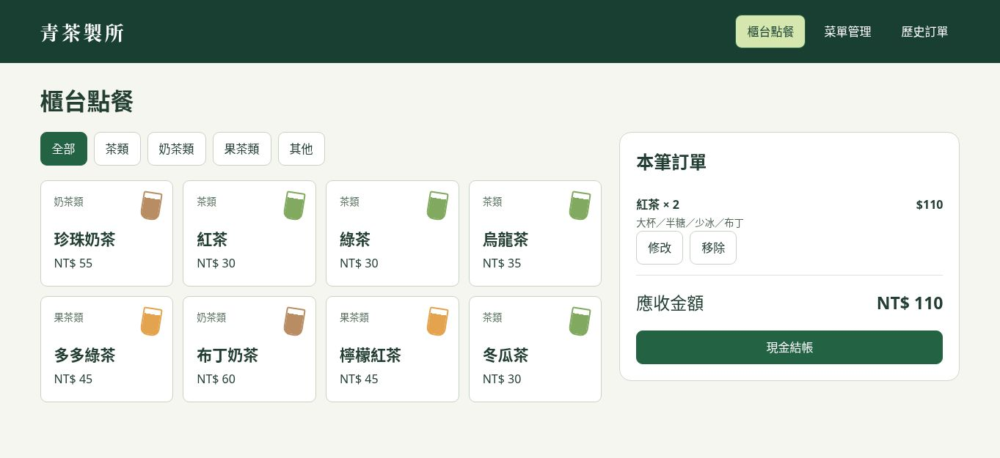
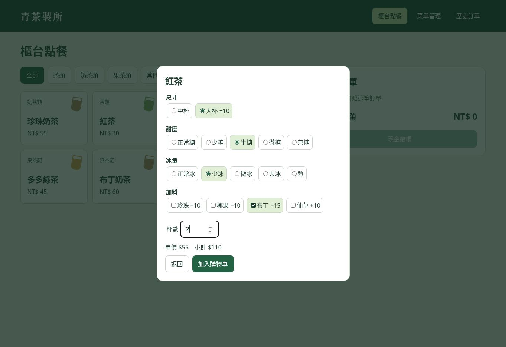
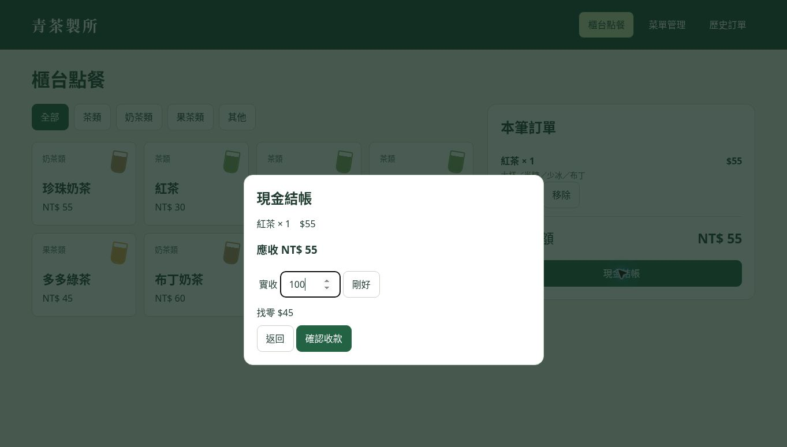
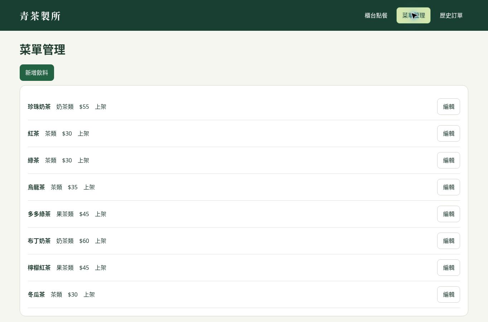
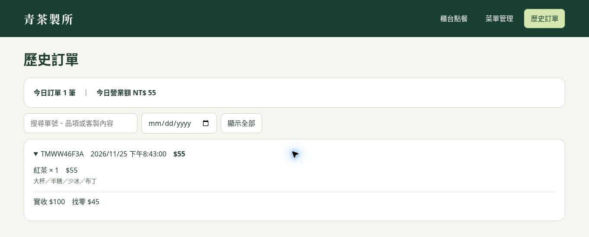
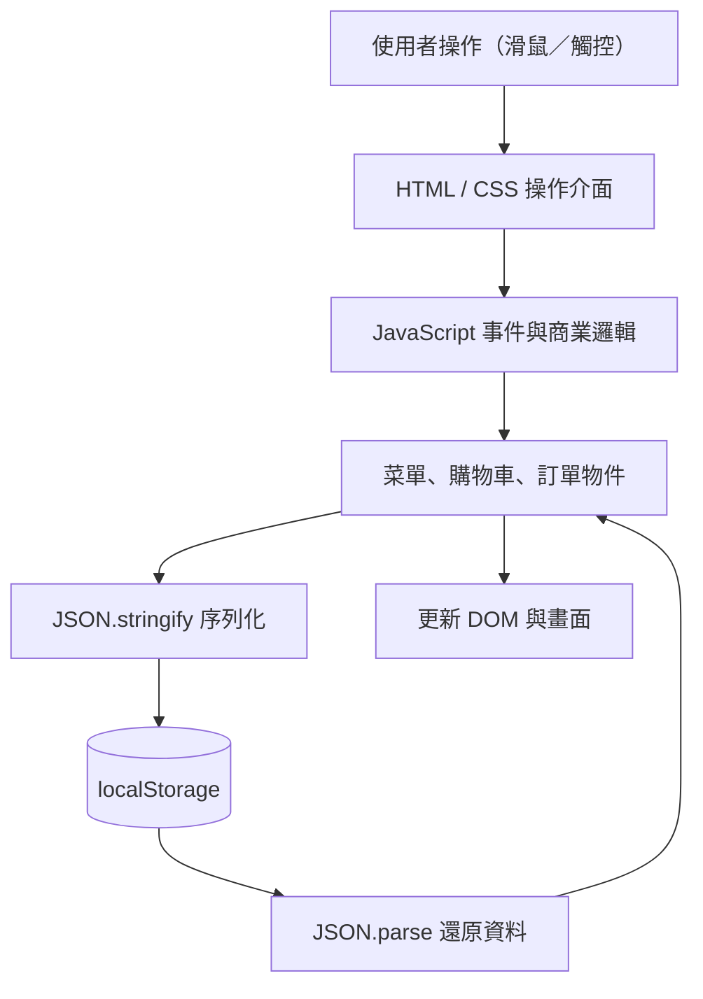
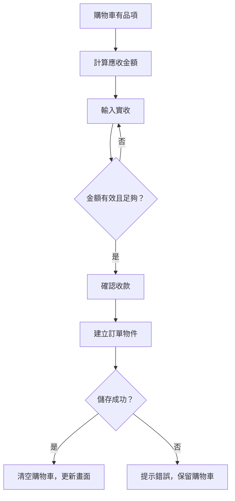

# 青茶製所｜飲料店點餐管理系統 Web POS

以 C# Windows Forms 飲料店點餐管理系統為基礎，結合 AI Coding，延伸開發成可直接在瀏覽器操作的茶飲櫃台 POS（Point of Sale，銷售時點管理系統）。

**[線上操作 Demo](https://48976369.github.io/TeaShopWeb/)** ｜ [V1.0 C# WinForms 專案](https://github.com/48976369/TeaShopOrderSystem)

## 一、專案簡介

本專案模擬飲料店櫃台從選擇飲料、客製化、購物車管理、現金結帳到歷史訂單查詢的工作流程。

V2.0 將原有桌面應用程式遷移至 Web，保留點餐、價格計算、菜單管理及訂單查詢等功能，並提供分類式飲料卡片、適合觸控操作的介面、購物車改單、即時計價及收款找零。使用 HTML、CSS 與原生 JavaScript 開發，不需安裝其他套件或架設後端即可操作。

本專案同時作為 AI 輔助程式開發的實作作品，呈現既有程式的需求延伸、介面重製、功能整合、資料儲存方式調整與網站部署。



*櫃台點餐介面：左側為飲料分類與品項，右側顯示客製內容、購物車及應收金額。以下截圖皆為系統實際操作的示範資料。*

## 二、使用技術

| 技術 | 應用 |
| --- | --- |
| HTML5 | 建立頁面結構、點餐表單、對話視窗 |
| CSS3 | 介面樣式、CSS Grid、Flexbox、響應式版面 |
| Vanilla JavaScript | DOM 操作、事件處理、客製化、價格計算及訂單查詢 |
| Web Storage API | 使用 localStorage 保存菜單、購物車及歷史訂單 |
| JSON | 將 JavaScript 物件與陣列轉換為可儲存的字串 |
| Git / GitHub | 版本控制與開源程式碼管理 |
| GitHub Pages | 靜態網站部署 |

## 三、主要功能

### 1. 櫃台點餐

- 以飲料卡片顯示品名、分類及基本價格。
- 支援全部、茶類、奶茶類、果茶類及其他分類篩選。
- 點選上架品項後，選擇尺寸（中杯、大杯）、甜度、冰量、加料及杯數（1–99 杯）。
- 客製化時即時更新單價及小計。



*客製化點餐：選擇大杯紅茶加布丁，單價 NT$55，兩杯小計 NT$110。*

### 2. 購物車管理

- 顯示飲料名稱、客製內容、數量與小計。
- 支援修改已加入的品項，並帶回先前選擇的客製內容。
- 支援移除品項及自動重新計算訂單總金額。
- 重新整理網頁後保留上次尚未完成的購物車。

### 3. 現金結帳

- 顯示訂單品項及應收總金額。
- 支援輸入實收金額或使用「剛好」快速填入應收金額。
- 即時計算找零與不足金額；未達應收金額時，不可確認收款。
- 尚未確認收款時可返回購物車修改。
- 成功儲存後自動建立訂單編號、記錄交易時間及金額，並清空購物車。

> 結帳功能為現金收款流程模擬，未串接實際金流服務。



*購物車修改為一杯後結帳，系統即時計算找零 NT$45。*

### 4. 菜單管理

- 新增、修改及刪除飲料品項。
- 設定品名、分類、基本價格與上架狀態。
- 下架品項不會顯示在櫃台點餐的品項區。
- 防止空白或重複品名，並透過數字欄位限制價格範圍。
- 每次儲存菜單變更時立即更新本機資料。



*菜單管理：可新增飲料，或編輯既有品項的基本資料與上架狀態。*

### 5. 歷史訂單與營業統計

- 依訂單為單位顯示訂單編號、交易時間及總金額。
- 展開訂單可查看所有飲料明細、客製內容、杯數、小計、實收及找零。
- 支援依日期及關鍵字（單號、飲料名稱、客製內容）組合搜尋。
- 顯示當日訂單數與營業額。



*完成收款後，歷史訂單可展開查看客製選項、成交金額、實收與找零，並同步顯示今日營業統計。*

## 四、系統架構與運作原理

本版本為純前端系統，所有點餐邏輯與資料操作均在使用者的瀏覽器執行。



1. 初次開啟網站時，JavaScript 讀取 localStorage；尚無儲存資料時載入預設菜單。
2. 使用者操作點餐、改單或菜單管理時，事件處理函式會讀取輸入並更新程式資料。
3. 儲存函式將更新後的物件轉換為 JSON 字串，寫入 localStorage。
4. 儲存成功後重新渲染相應畫面，使介面與資料保持一致。
5. 重新開啟同一瀏覽器、同一網站時，程式可還原先前儲存的資料。

### 價格計算規則

| 項目 | 價格規則 |
| --- | --- |
| 中杯 | 飲料基本價格 |
| 大杯 | 基本價格 + NT$10 |
| 珍珠、椰果、仙草 | 每種 + NT$10 |
| 布丁 | + NT$15 |
| 甜度、冰量 | 不另外收費 |

- 單價 = 基本價格 + 尺寸加價 + 所有加料費用。
- 品項小計 = 單價 × 杯數。
- 應收金額 = 所有品項小計的加總。
- 找零 = 實收金額 − 應收金額。

### 結帳處理流程



系統將新訂單與清空後的購物車合併成同一份更新資料，成功寫入後才更新當前狀態，降低儲存失敗造成訂單遺失的風險。

## 五、資料儲存與結構

使用 localStorage 鍵值 `qingcha.pos.v1` 儲存 JSON，主要包含三個陣列：

| 陣列 | 用途 | 主要欄位 |
| --- | --- | --- |
| `menu` | 飲料菜單 | id、name、cat、price、on |
| `cart` | 尚未完成的購物車 | id、name、base、size、sugar、ice、extras、qty |
| `orders` | 歷史訂單 | id、time、items、total、cash |

資料結構範例（單筆訂單）：

```json
{
  "id": "TEXAMPLE",
  "time": 1795568400000,
  "items": [
    {
      "id": "D002",
      "name": "紅茶",
      "base": 30,
      "size": "大杯",
      "sugar": "半糖",
      "ice": "少冰",
      "extras": ["布丁"],
      "qty": 1
    }
  ],
  "total": 55,
  "cash": 100
}
```

訂單明細保存當時的飲料名稱、基本價格及客製選項，訂單物件另保存總金額及實收金額。日後修改或刪除菜單品項時，已建立的歷史訂單仍可查看原本的資料。

**目前版本限制：** localStorage 資料存於各自的瀏覽器與網站來源，不會跨裝置同步；清除網站資料可能使記錄遺失。本版本尚未導入 SQL、後端 API 或登入權限，適合單機操作及作品展示。

## 六、操作說明

### 1. 點餐與改單

1. 進入「櫃台點餐」，選擇飲料分類及品項。
2. 在客製化視窗設定尺寸、甜度、冰量、加料及杯數。
3. 確認價格後按「加入購物車」。
4. 若客人臨時變更需求，點選該品項的「修改」，調整後按「儲存修改」。
5. 若要取消品項，按「移除」。

### 2. 結帳

1. 確認購物車與應收金額，按「現金結帳」。
2. 輸入顧客實收金額，或使用「剛好」。
3. 確認找零後按「確認收款」。
4. 系統建立訂單並清空購物車。

### 3. 菜單管理

1. 進入「菜單管理」。
2. 按「新增飲料」或選擇既有品項的「編輯」。
3. 設定品名、分類、基本價格與上架狀態。
4. 按「儲存」；若要永久移除既有品項，可在編輯畫面按「刪除」並確認。
5. 回到櫃台點餐，即可看到更新後的菜單。

### 4. 歷史訂單

1. 進入「歷史訂單」。
2. 查看今日訂單筆數及營業額。
3. 選擇日期或輸入關鍵字篩選資料。
4. 點選訂單展開完整交易明細；按「顯示全部」清除篩選。

## 七、專案結構

```text
TeaShopWeb/
├── index.html   # HTML 結構與 CSS 介面樣式
├── app.js       # 點餐、結帳、資料處理與畫面更新
├── images/      # README 功能展示截圖
├── README.md    # 專案介紹與操作文件
└── LICENSE      # MIT 開源授權
```

`app.js` 的核心函式：

| 函式 | 用途 |
| --- | --- |
| `render()` | 切換頁面及重新渲染畫面 |
| `pos()`、`custom()` | 飲料篩選、客製化與購物車新增／修改 |
| `price()`、`sum()` | 單價及訂單總金額計算 |
| `checkout()` | 實收驗證、找零及訂單建立 |
| `menu()`、`editMenu()` | 菜單顯示及 CRUD 操作 |
| `history()` | 歷史訂單搜尋與今日營收統計 |
| `save()` | JSON 序列化及 localStorage 儲存 |

## 八、執行方式

### 線上使用

開啟 [GitHub Pages 線上 Demo](https://48976369.github.io/TeaShopWeb/) 即可操作。

### 本機使用

1. 在 GitHub 專案首頁選擇 **Code → Download ZIP**。
2. 解壓縮所有檔案。
3. 使用 Chrome 或 Edge 開啟 `index.html`（建議使用近期版本的瀏覽器）。
4. 即可操作系統，無需安裝 Node.js、Visual Studio 或資料庫。

### GitHub Pages 部署

1. 將 `index.html` 與 `app.js` 放在 GitHub 儲存庫根目錄。
2. 進入 **Settings → Pages**。
3. Source 選擇 **Deploy from a branch**。
4. 選擇 `main` 分支與 `/(root)`，按 Save。
5. 部署完成後即可透過網站網址操作。

## 九、功能展示情境（Demo）

| 操作 | 預期結果 |
| --- | --- |
| 選擇紅茶、大杯、半糖、少冰、布丁、2 杯 | 單價 NT$55，總額 NT$110 |
| 修改購物車的杯數為 1 杯 | 總額更新為 NT$55 |
| 結帳時輸入實收 NT$50 | 顯示還差 NT$5，無法確認收款 |
| 將實收改為 NT$100 | 顯示找零 NT$45 |
| 確認收款 | 購物車清空，建立一筆訂單 |
| 前往歷史訂單 | 可查看該筆明細、實收及找零 |
| 重新整理網頁 | 已儲存的訂單仍可查詢 |

## 十、版本演進

| 項目 | V1.0：C# WinForms | V2.0：Web POS |
| --- | --- | --- |
| 執行環境 | Windows 桌面程式 | 瀏覽器 |
| 技術 | C#、.NET Framework、WinForms | HTML、CSS、JavaScript |
| 介面 | 視窗控制項、表格 | 飲料卡片、響應式介面 |
| 資料儲存 | CSV 檔案 | localStorage、JSON |
| 訂單流程 | 點餐、購物車、訂單儲存 | 點餐、購物車改單、收款找零與訂單查詢 |
| 分享方式 | 下載並於 Windows 執行 | GitHub Pages 網址 |

## 十一、授權

本專案採用 MIT License，詳見 [LICENSE](LICENSE)。
